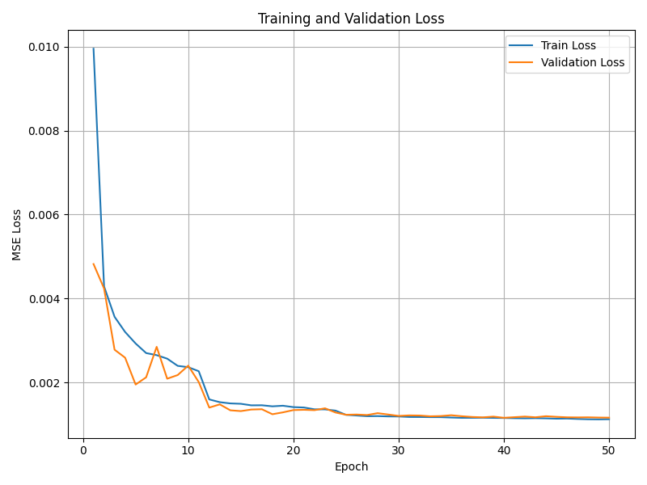
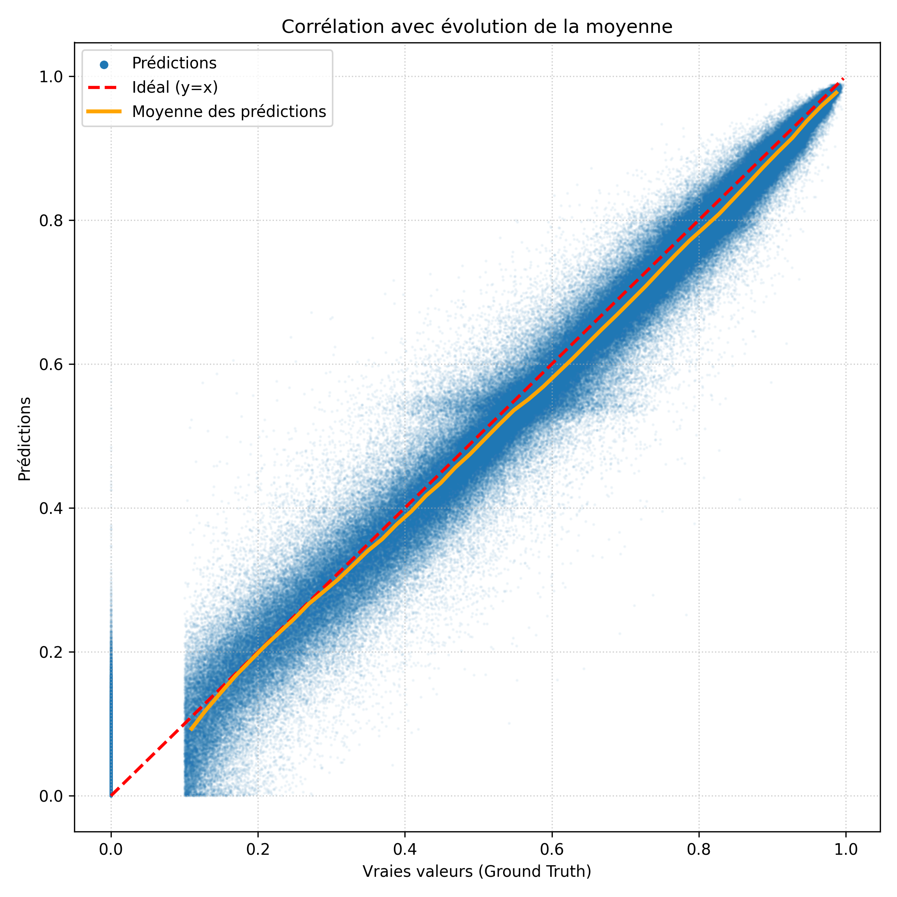

# 🧠 MSAR Surrogate Model (Deep Spatiotemporal Metamodel)

[](https://www.python.org/)
[](https://pytorch.org/)
[](https://developer.nvidia.com/cuda-toolkit)
[](https://microsoft.com)

**MSAR Surrogate Model** is an experimental deep learning metamodel designed to approximate the **Probability of Success (POS)** computed by the GPU-accelerated **Maritime Search and Rescue (MSAR) Search Simulator**.

**WE ARE NOT RELEASING THIS CODE FOR AN OPERATIONAL SYSTEM INTENDED FOR SEARCH AND RESCUE**

By encoding drifting particle clouds with a **PointNet + Temporal Transformer** architecture and querying them with Search and Rescue Unit (SRU) configurations via **Cross-Attention**, the surrogate model enables near-instantaneous POS evaluation for large batches of candidate search strategies and downstream black-box optimization.

---

## 📚 Citation

This repository is the implementation of the research presented in the following forthcoming paper *(accepted at WSC 2026, publication pending)*:

> **Adam Boukhari and Michael Morin (2026).** [*Neural Spatiotemporal Metamodel of Search Simulations for Maritime Search and Rescue Planning*](https://www.michaelmorin.info/publications/ab2026wsc.pdf). *Proceedings of the 2026 Winter Simulation Conference (WSC)*, IEEE *(To appear)*.

The paper introduces a neural spatiotemporal metamodel designed to rapidly approximate Maritime Search and Rescue (MSAR) simulation outcomes, enabling fast Probability of Success (POS) estimation and accelerating search plan optimization in decision support systems.

**If you use, modify, or build upon this metamodel in your research, please cite the paper using the following BibTeX reference *(DOI/pages to be updated upon final WSC 2026 publication):***

```bibtex
@inproceedings{Boukhari_Morin_2026_WSC,
  author    = {Boukhari, Adam and Morin, Michael},
  title     = {Neural Spatiotemporal Metamodel of Search Simulations for Maritime Search and Rescue Planning},
  booktitle = {Proceedings of the 2026 Winter Simulation Conference (WSC)},
  publisher = {IEEE},
  year      = {2026},
  url       = {https://www.michaelmorin.info/publications/ab2026wsc.pdf},
  note      = {Accepted, to appear}
}
```

This surrogate model builds directly upon the physics-based simulator and MSAR decision-support literature:

- **[MSAR Search Simulator (Boukhari & Morin, 2026)](https://ojs.iscram.org/index.php/Proceedings/article/view/291)** – *Multi-Threading and GPU Acceleration: The Case for Faster Simulators for Maritime Search and Rescue Operations Planning* ([GitHub Repository](https://github.com/AdamBoukhari/MSAR-Search-Simulator)).

---

## 🏛️ Project Structure

The project is organized around three main components: the **neural metamodel & training pipeline** (`Model/`), the **dataset generation & augmentation pipeline** (`DatasetGeneration/`), and the **evaluation, benchmarking & optimization suite** (`Experiments/`), supported by shared simulator domain utilities (`Controller/`, `Repository/`, `Utilities/`).

```text
MSAR-SurrogateModel/
├── Model/                           # Deep learning model, datasets, and training loop
│   ├── model.py                     # SurrogateModel architecture (PointNet + Transformer + Cross-Attention)
│   ├── dataset.py                   # PyTorch Dataset classes (DriftDataset, DriftValidationDataset)
│   ├── Train.py                     # Training & validation loop (Trainer, checkpointing, loss/correlation plots)
│   └── testDataset.py               # Dataset label distribution inspection script
│
├── DatasetGeneration/               # Dataset creation, particle reduction, augmentation & inspection
│   ├── DatasetGenerationComplete.py # Multi-threaded batch generator producing compressed .dataset.npz files
│   ├── DatasetAugmentation.py       # Global Sobol augmentation merged into InputOutputAugmented
│   ├── DriftReducer.py              # Particle trajectory subsampling utility (reduces drift clouds to 500 particles)
│   └── DatasetReader.py             # Interactive CLI to inspect individual samples in .dataset.npz files
│
├── Experiments/                     # Evaluation, optimization benchmarks, and visualization scripts
│   ├── ModelLoader.py               # Unified interface (SimulatorLoader vs. SurrogateLoader)
│   ├── CMA.py                       # CMA-ES optimization benchmark (Surrogate vs. Simulator)
│   ├── RandomSearch.py              # Random search optimization benchmark
│   ├── ILRCleaner.py                # Refactored / combined local refinement & CMA evaluation script
│   ├── optimizerFolder.py           # Batch & single-drift CLI comparing optimizers (CMA-ES, Nevergrad, Optuna, DE)
│   ├── througput.py                 # Throughput and inference speed benchmarking CLI
│   ├── heatmap.py                   # 2D spatial POS heatmap comparison (Simulator vs. Surrogate)
│   ├── colorbar.py                  # Standalone colorbar plotting utility
│   └── TrajectoryVisualization.py   # Drift particle trajectory (filament) visualization script
│
├── dataset/                         # Pre-generated drift and strategy I/O datasets (.npz)
│   ├── DriftReduced/                # North America particle drift trajectories via OpenDrift (train / validation)
│   ├── InputOutput/                 # Initial SRU configurations and ground-truth POS targets (train / validation)
│   └── InputOutputAugmented/        # Augmented SRU input/output datasets used for training (train / validation)
│
├── output/                          # Saved checkpoints and training diagnostic figures
│   ├── best_model.pt                # Best validation checkpoint
│   ├── final_model.pt               # Final epoch model weights
│   ├── loss_plot.png                # Training vs. validation MSE loss curve
│   ├── correlation_scatter_plot.png # Ground-truth vs. predicted POS scatter plot with binned mean
│   └── Ancient_Correlation_plot.png # The first time the model learned something so I kept it there
│
├── Controller/                      # Simulator configuration enums (SimulatorType)
├── Repository/                      # Detection function repository (FunctionRepository)
├── Utilities/                       # Domain objects & helpers (Object, Particle, SearchZone, GeoTransform, etc.)
```

### Folder Breakdown

- **`Model/` — Architecture, Data Loading & Training Loop**
  - `model.py`: Defines `SurrogateModel`, combining a `VanillaPointNet` spatial particle encoder, sinusoidal `PositionalEncoding`, a `TransformerEncoder` across drift timesteps, and an SRU self-attention + cross-attention decoder with a sigmoid MLP head outputting the predicted POS in `[0, 1]`.
  - `dataset.py`: Implements `DriftDataset` and `DriftValidationDataset` to load `.npz` particle trajectories and corresponding SRU strategy batches, applying coordinate normalization relative to the initial drift origin and time scaling.
  - `Train.py`: Implements the `Trainer` class with `MSELoss`, `AdamW` optimizer, `ReduceLROnPlateau` scheduler, optional early stopping, automatic saving of `best_model.pt` / `final_model.pt`, and generation of loss and correlation plots in `output/`.

- **`DatasetGeneration/` — Dataset Construction & Augmentation**
  - `DatasetGenerationComplete.py`: Generate ground-truth `(SRU configurations, POS)` datasets by querying the CUDA `Simulator` across Sobol sequences of SRU positions and start times (`DatasetGenerationComplete.py` runs multi-threaded over a drift folder and outputs compressed `.dataset.npz` archives).
  - `DatasetAugmentation.py`: Supplements existing `.dataset.npz` files with additional global Sobol samples across each drift bounding box and merges them into `InputOutputAugmented`.
  - `DriftReducer.py` & `DatasetReader.py`: Subsample raw drift particle clouds (`target_N = 500`) for storage efficiency and inspect generated `.dataset.npz` samples from the terminal.

- **`Experiments/` — Evaluation, Optimization & Benchmarking**
  - `ModelLoader.py`: Exposes a common `BaseDriftModel` abstraction implemented by both `SimulatorLoader` (wrapping the C++/CUDA physics simulator) and `SurrogateLoader` (wrapping the trained PyTorch model), allowing every experiment script to evaluate both side by side.
  - **Optimization Benchmarks** (`CMA.py`, `RandomSearch.py`, `ILRCleaner.py`, `optimizerFolder.py`): Compare convergence quality and wall-clock speed when searching for optimal SRU placements using CMA-ES, Nevergrad, Optuna, Differential Evolution, Random Search, and Iterated Local Refinement.
  - **Performance & Qualitative Analysis** (`througput.py`, `heatmap.py`, `TrajectoryVisualization.py`, `colorbar.py`): Measure batch evaluation throughput, generate 2D spatial POS heatmaps comparing surrogate predictions against the physics simulator, and visualize particle drift trajectories.

- **`Controller/`, `Repository/`, `Utilities/` — Simulator Bridge**
  - Provide the Python domain classes (`Object`, `Particle`, `SearchZone`, `Position`, `FunctionRepository`, `SimulatorType`) required by `SimulatorLoader` to construct scenarios and query the compiled CUDA `Simulator` extension during ground-truth evaluations.

- **`dataset/` — Drift & Strategy Datasets**
  - **`DriftReduced/`**: Particle drift trajectories generated in **North America** using [OpenDrift](https://opendrift.github.io/) ([GitHub](https://github.com/opendrift/opendrift)), reduced to 500 particles per scenario (`train` / `validation`).
  - **`InputOutput/` & `InputOutputAugmented/`**: Ground-truth SRU configurations and simulator POS targets generated for the corresponding drift scenarios (`InputOutputAugmented/` is used for training).

---

## ⚙️ Model Scope & Fixed Assumptions

The surrogate model was trained on a specific simulation configuration to isolate spatial-temporal search placement. Consequently, **only each SRU's position and start time can vary at inference/optimization time**; all other search, target, and detection parameters are held fixed in the training data and `SimulatorLoader`:

- **Variable Inputs (per SRU):**
  - **2D Position `(lon, lat)`**: normalized relative to the drift origin `(start_lon, start_lat)`, with absolute latitude scaled by `90.0` (`lat / 90.0`).
  - **Start Time `time`**: offset in seconds from the drift start timestamp, normalized as `(time - 2*3600) / (40*3600)` (spanning the 2 h – 42 h search window).
  - **Number of SRUs**: handled via binary masking (`mask = 1` for active SRUs, `0` for padding; experiment benchmarks evaluate up to `MAX_SRU = 5`).

- **Fixed SRU & Simulation Parameters (cannot be changed without retraining):**
  - **Search Zone Geometry & Pattern:** `width = 35`, `height = 41`, `rotation = 0`, parallel lined pattern (`typeSearch.lined`), `vehicule = boat`.
  - **SRU Kinematics & Effort:** `endeavorHour = 2`, `searchSpeed = 160`, `transitSpeed = 160` (`endeavor = 320`).
  - **Target & Detection Model:** `RAFT` (`ObjectType.person`, `rad = 100.0`) with a Gaussian lateral range curve (`LRC`, `height = 0.8`, `threshold = 2.82`).
  - **Drift Representation:** `256` sampled particle trajectories (`drift_size = 256`) centered at `(start_lon, start_lat)` over `577` timesteps (`T = 577`, 5-minute steps / 48 h, padded with the final position if shorter).

---

## 💻 System & Dependency Prerequisites

To train the metamodel and run the evaluation/optimization experiments, you need the following setup:

### 1. Hardware & System Requirements

| Tool | Required Version | Purpose |
| :--- | :--- | :--- |
| **Operating System** | Windows 10 / 11 (64-bit) *(or Linux)* | Host environment |
| **NVIDIA GPU** | CUDA-capable GPU (e.g., RTX 20/30/40 series) | Fast PyTorch training/inference & CUDA simulator execution |
| **Python** | **3.12 (64-bit)** *(Recommended)* | Matches ABI of the compiled MSAR `Simulator` module |
| **NVIDIA CUDA Toolkit** | 12.x | GPU acceleration for PyTorch and the `Simulator` backend |

### 2. Required External Repository: MSAR Search Simulator

The dataset generation (`DatasetGeneration/`) and evaluation/optimization scripts (`Experiments/`, via `SimulatorLoader` in `Experiments/ModelLoader.py`) depend directly on the compiled **`Simulator`** Python/CUDA module from the MSAR Search Simulator project:

- **MSAR Search Simulator Repository:** [GitHub Repository](https://github.com/AdamBoukhari/MSAR-Search-Simulator)

> [!IMPORTANT]
> Make sure the `Simulator` package from the simulator repository is compiled and installed (`pip install .`) inside the same Python virtual environment used for this project so that `import Simulator` resolves cleanly.  
> *(Training-only scripts in `Model/` rely solely on pre-generated `.npz` datasets in `dataset/` and do not call `Simulator` directly.)*

### 3. Python Dependencies

The codebase uses the following Python packages:

- **Deep Learning & Core Numerics:** `torch` (CUDA-enabled build), `numpy`, `scipy`, `tqdm`, `matplotlib`, `sobol_seq`
- **Black-Box Optimization (`Experiments/`):** `cma`, `nevergrad`, `optuna`
- **Simulator Utilities (`Utilities/`):** `geopy`, `PyQt5`

You can install the Python dependencies into your virtual environment with:

```bash
pip install torch numpy scipy matplotlib tqdm sobol_seq cma nevergrad optuna geopy PyQt5
```

*(Ensure you install the CUDA-enabled wheel of PyTorch matching your CUDA toolkit version from [pytorch.org](https://pytorch.org/get-started/locally/).)*

---

## 📊 Training & Validation Results

The current checkpoints in `output/` (`best_model.pt` and `final_model.pt`, trained via `Model/Train.py` for 50 epochs with `MSELoss`, `AdamW` at `lr = 1e-3`, and `ReduceLROnPlateau`) show strong convergence and generalization on the validation set:

- **Convergence (`output/loss_plot.png`):** Training MSE starts around `0.010` at Epoch 1 (validation around `0.0048`), drops sharply around Epoch 12 after learning-rate reduction, and stabilizes smoothly around `~0.0011–0.0012` for both training and validation losses through Epoch 50, with no signs of overfitting.
- **Calibration & Correlation (`output/correlation_scatter_plot.png`):** Predicted Probability of Success (POS) values cluster tightly along the ideal `y = x` diagonal, and the 50-bin mean prediction curve closely tracks `y = x` across the full non-zero POS range (`~0.1` to `1.0`).

| Training & Validation MSE Loss | Predicted vs. Ground-Truth POS |
| :---: | :---: |
|  |  |

---

## 📄 License

This project is licensed under the MIT License. See the `LICENSE` file for more details.
